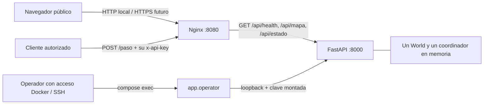

# Docker Compose: ejecución completa local

Dos servicios: backend Python 3.12 con un proceso/worker/coordinador y frontend
compilado con Node 24, servido por Nginx. No requiere instalar Python ni Node en
el equipo que solo vaya a ejecutar Docker. No crea recursos AWS.

Las tres imágenes base están fijadas por digest, además de las versiones de
Python/Node y las dependencias directas del proyecto. Actualizar esos digests requiere
reconstruir y repetir la validación; no se descargan versiones nuevas de base
silenciosamente en cada máquina.

## Auditoría y solución de arranque

El Dockerfile original ya incluía Python 3.12, instalación del paquete, usuario
sin privilegios y `data/` desde el contexto raíz. `sniffio==1.3.1` sigue fijado en
`backend/pyproject.toml`. Su CMD `app.server:app` publicaba el estado inicial pero
no iniciaba un reloj. No había Compose ni imagen/frontend proxy de producción.
`app.dashboard_server` ya resolvía el reloj persistente, pero ligado a loopback;
la CLI creaba su servidor y terminaba tras ejecutar las rondas. El proxy Vite
solo existía en desarrollo.

El nuevo `app.container_server` reutiliza `create_app` y `SimulationControl`:
escucha dentro del contenedor en 0.0.0.0:8000, fija un worker y exige dos segundos
por turno. Hay una sola tarea dueña del reloj; los GET no avanzan turnos. Al
terminar, conserva el último estado y sigue sirviendo HTTP. Reiniciar una ronda
cancela y espera la tarea anterior antes de reemplazar el mundo. No se cambiaron
predicción, heurísticas, mapa, escenarios, velocidades ni física.

La aceptación por Nginx detectó que el cálculo síncrono de un turno podía bloquear
peticiones externas durante más de 500 ms. Las fases de CPU del coordinador ahora
se ejecutan secuencialmente en un hilo del mismo proceso, bajo el mismo lock;
el bucle HTTP permanece disponible. No hay otro World, worker ni reloj. Cancelar
una ejecución espera a que termine su fase antes de liberar el lock y reemplazar
el mundo. El estado público se actualiza solo al completar un turno válido.



El backend no tiene puertos publicados. Solo pertenece a una red `internal`.
Nginx pertenece además a la red web y publica 127.0.0.1:8080 por defecto. Ambos
contenedores usan filesystem de solo lectura, tmpfs, usuario sin privilegios,
capacidades eliminadas y logs rotados. El init de Docker no es otro worker de
aplicación. No habilitar réplicas adicionales ni escalado horizontal.

El proxy usa `Referrer-Policy: strict-origin-when-cross-origin`: los tiles de OSM
requieren un Referer válido y esa política envía solo el origen entre sitios.
No descarga tiles masivamente ni crea un cache OSM empaquetado. Si el proveedor
no responde, se retira su capa fallida y permanece el grafo vial real incluido
en la imagen, con entidades y selección operativas. No es un paquete de tiles
offline. Ver [política oficial de tiles](https://operations.osmfoundation.org/policies/tiles/).

## Preparar Windows con Docker Desktop

Docker Desktop debe estar iniciado en modo **contenedores Linux**, con WSL2
habilitado. Comprobar `docker version` y `docker compose version`. Se recomienda
tener al menos 4 GB de memoria disponibles para Docker durante la compilación;
es un margen inicial, no un requisito de rendimiento medido para todos los equipos.

Desde la raíz del repositorio, copiar la configuración **solo si no existe**:

```powershell
if (-not (Test-Path .env)) { Copy-Item .env.docker.example .env }
New-Item -ItemType Directory -Force .secrets | Out-Null
if (-not (Test-Path .secrets/api_key)) {
    $keyPath = Join-Path (Get-Location) '.secrets/api_key'
    $keyBytes = [Text.Encoding]::UTF8.GetBytes(([Guid]::NewGuid().ToString('N') + [Guid]::NewGuid().ToString('N')))
    $stream = [IO.File]::Open($keyPath, [IO.FileMode]::CreateNew, [IO.FileAccess]::Write, [IO.FileShare]::None)
    try { $stream.Write($keyBytes, 0, $keyBytes.Length) } finally { $stream.Dispose() }
    [Array]::Clear($keyBytes, 0, $keyBytes.Length)
}
```

No imprime ni sobrescribe una clave existente. Si ya existe `.env`, revisar sus
valores comparándolos con `.env.docker.example` sin sobrescribirlo. `.env` y
`.secrets/` están ignorados por Git y por los contextos Docker.

En Linux/macOS, con OpenSSL instalado:

```bash
test -f .env || cp .env.docker.example .env
mkdir -p .secrets
chmod 700 .secrets
if [ ! -f .secrets/api_key ]; then
  (umask 077; set -C; openssl rand -hex 32 > .secrets/api_key)
fi
```

En Linux, el usuario `backend` de la imagen usa UID 1000; la clave montada debe
ser legible por ese UID. Compose local monta el archivo, no lo cifra ni sustituye
un gestor de secretos. Mantener sus permisos y el acceso al daemon bajo control.
No usar `chmod 777` para resolver permisos.

## Construir y arrancar

```shell
docker compose config --quiet
docker compose build
docker compose up -d
docker compose ps
docker compose logs --tail=100
```

Esperar a que ambos servicios estén `healthy`. Abrir
**http://127.0.0.1:8080**. La API pública de lectura está en `/api/health`,
`/api/mapa` y `/api/estado` de ese mismo origen. No se utiliza Vite Dev Server.
El backend inicialmente queda disponible, esperando una orden del operador.

## Iniciar y reiniciar sin reconstruir imágenes

```shell
docker compose exec -T backend python -m app.operator start --round 1
docker compose exec -T backend python -m app.operator status
docker compose exec -T backend python -m app.operator start --round 3
```

`start` inicia o reemplaza la ejecución actual. Las rondas oficiales tienen 150
turnos, y la tercera comienza con 200 supervivientes. No ejecutar otra CLI, otro
Uvicorn ni otro coordinador dentro del contenedor. `app.operator` es solo un
cliente HTTP de la aplicación ya abierta: lee la clave montada y se conecta a
127.0.0.1:8000, sin crear ningún World.

Para una prueba breve, conservando dos segundos por turno:

```shell
docker compose exec -T backend python -m app.operator start --round 1 --turns 3 --seed 7
```

Para configurar cantidades y averías, preparar un JSON con el contrato
`SimulationRequest` de `contracts/dashboard-control.openapi.yaml`. Por ejemplo:

```json
{
  "ronda": 3,
  "sobrevivientes": 200,
  "zombies": {"caminante": 24, "corredor": 12, "horda": 4, "dormido": 8},
  "turnos": 150,
  "semilla": 7,
  "estrategia": "pro",
  "distribucion": "equilibrada",
  "bloqueos": true,
  "averias": {"activadas": true}
}
```

Las reglas de avería omitidas usan los valores predeterminados documentados en
[averias.md](averias.md). Para probabilidades y duración personalizadas añadir
por tipo `{ "probabilidad": 0.5, "turnos": 3 }` dentro de `averias`.
Guardar el JSON localmente, por ejemplo en `reports/prueba.json`, y enviarlo:

```powershell
Get-Content reports/prueba.json -Raw | docker compose exec -T backend python -m app.operator start --config -
```

En Bash: `docker compose exec -T backend python -m app.operator start --config - < reports/prueba.json`.
Este canal no requiere colocar la clave en argumentos ni en el navegador.

## Seguridad pública y del operador

En producción se ocultan **Pruebas de fuego** y la capa de dormidos de depuración.
Esas opciones siguen disponibles en el desarrollo local con Vite. La imagen web
no recibe ningún secreto. Nginx admite solo las tres lecturas `/api/*` y
`POST /paso`, más `GET /api/control/estado` y `POST /api/control/iniciar` (botón **Pruebas de fuego**, exigen la clave de operador en `x-api-key` y tienen límite de 10 peticiones/min). `/api/control/dormidos`, `/control*`, `/docs` y `/openapi.json` devuelven 404.
El backend sigue exigiendo la clave para todos los controles incluso dentro de
la red privada. No hay protección de producción basada solamente en Host/Origin.

El cliente autorizado/jurado envía su propia `x-api-key` al endpoint **`/paso`**,
sin `/api`. Nginx la transmite sin agregar ni reemplazar la credencial. Para
probar manualmente desde el host, leer la clave solo en memoria y usar un actor,
nodo y turno compatibles. Los ejemplos bajo `docs/paso.example.json` conservan
el contrato; un nodo inventado puede producir 409 aunque la clave sea correcta.
Una petición válida sin clave o con clave incorrecta devuelve 401. Los límites
del proxy son 16 KiB por cuerpo, conexión 3 s y lectura/envío 10 s; el límite
medido de decisión del coordinador se conserva en 500 ms.

No enviar una clave real por HTTP en una red pública: antes se necesita HTTPS.
El HTTP local de esta entrega está ligado a loopback. Para administrar remotamente
usar SSH y ejecutar los mismos comandos en el host. Quien controla el daemon
Docker tiene privilegios elevados; limitar ese acceso al operador.

## Guardar resultados sin perderlos ni subirlos a Git

Los contenedores no guardan reportes en su filesystem efímero. Exportar el estado
final y las 25 métricas al host, con nombre único y sin sobrescribir:

```powershell
$stamp = Get-Date -Format 'yyyyMMdd-HHmmss-fff'
docker compose exec -T backend python -m app.operator export | Out-File -Encoding utf8 -NoClobber "reports/docker-$stamp.json"
docker compose logs --no-color | Out-File -Encoding utf8 -NoClobber "reports/docker-$stamp.log"
```

Exportar antes de reiniciar una ronda, recrear contenedores o apagarlos. Solo se
conserva el último estado en memoria; no se afirma persistencia compartida. Los
archivos del host permanecen al hacer `down` y están ignorados por Git. No usar
`git add -f` para incluirlos. `export` no sustituye al evaluador completo JSON/CSV
de la CLI: devuelve el estado público final y sus métricas, sin el historial total.

## Verificación completa con contenedores

Altera la ejecución Docker actual; no toca una instancia de desarrollo separada:

```powershell
$stamp = Get-Date -Format 'yyyyMMdd-HHmmss-fff'
docker compose exec -T backend python -m app.evaluation.container_check | Out-File -Encoding utf8 -NoClobber "reports/docker-aceptacion-$stamp.json"
```

Comprueba frontend y assets sin credenciales, proxy real, mapa, autenticación y
contrato `/paso`, controles bloqueados, 1.000 reintentos válidos del turno 0 por
Nginx más sondeos durante la ejecución activa, una
ronda 3 completa de 150 turnos a dos segundos, invariantes públicas, estado final
retenido y reinicio sin reconstruir. Requiere al menos cinco minutos; no acelera
el reloj ni cambia velocidades. Al terminar deja una prueba breve de ronda 1
finalizada. Las métricas del coordinador y del sondeo Nginx se informan por
separado. Es validación Docker local, no rendimiento AWS.

## Configuración efectiva

| Variable | Aplicación real |
| --- | --- |
| `API_KEY_SECRET_FILE` | Ruta del archivo secreto en el host que Compose monta. |
| `API_KEY_FILE` | Fijada a `/run/secrets/api_key` dentro del backend; carga la clave al iniciar. |
| `API_KEY` | Alternativa en el entorno para desarrollo; no combinar con `API_KEY_FILE`. No se pasa como valor en Compose. |
| `ROUTING_STRATEGY`, `SEED` | Inicialización del backend y valores del operador; `start --seed` o JSON puede sobrescribirlos para la nueva ronda. |
| `TURN_SECONDS` | Compose permite configurarla, pero el entrypoint rechaza cualquier valor distinto de 2. |
| `HTTP_CONCURRENCY` | Límite de solicitudes simultáneas del coordinador; predeterminado 16. |
| `PRO_PREDICTION`, `PRO_RESERVATIONS`, `PRO_FLEET` | Flags reales de Settings; se conservan al iniciar rondas Pro. |
| `MANTA_DATA_DIR` | Fijada a `/service/data`, con mapa, refugios, flota y escenarios incluidos. |
| `VITE_DATA_SOURCE`, `VITE_API_BASE_URL` | Fijadas a `api` y `/api` durante build; no cambian al editar el entorno de un contenedor ya construido. |
| `WEB_BIND`, `WEB_PORT` | Publicación de Nginx; predeterminados 127.0.0.1 y 8080. |

No hay variables de velocidades en Compose. Las opciones avanzadas siguen en
Settings, pero no se alteran para esta entrega. No imprimir `docker inspect` o
configuraciones ajenas que puedan contener secretos de otras aplicaciones.

## Logs, actualización y parada

```shell
docker compose logs --tail=100
docker compose logs -f backend
docker compose restart
docker compose up -d --build
docker compose stop
docker compose down
```

`restart` y `up --build` pueden perder la ejecución en memoria. Guardar resultados
antes. Compose sustituye los servicios del mismo proyecto; no ejecutar otro
proyecto sobre el mismo puerto. No matar procesos ajenos: si 8080 está ocupado,
detener la instancia anterior o elegir otro `WEB_PORT` en `.env` y recrear el
frontend. No borrar `.secrets/` para resolver problemas de arranque.

Para cambios de código, reconstruir y recrear, y volver a iniciar una ronda.
Para cambiar la clave, terminar/exportar la ejecución, detener los servicios,
reemplazar de forma privada el archivo y arrancar de nuevo. Nunca escribir la
clave en una imagen, un build-arg, un `VITE_*`, logs ni documentación pública.

## Fuentes y entrega

- [Secretos de Compose](https://docs.docker.com/reference/compose-file/secrets/).
- [Redes internas de Compose](https://docs.docker.com/reference/compose-file/networks/).
- [DNS dinámico de upstream en Nginx](https://nginx.org/en/docs/http/ngx_http_upstream_module.html#server).
- Preparación EC2 y HTTPS: [aws-predeploy.md](aws-predeploy.md).
- Resultados ejecutados y pendientes: [validacion_docker.md](validacion_docker.md).
